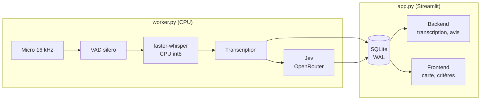

Hackathon DGE · Isère 2026

# La borne qui écoute

## Le livre d'or numérique des sites touristiques

Gestion des flux touristiques · Isère · Équipe 5

<!--
NOTES ORALES — accueil (15 s)

« Bonjour. Nous allons vous présenter La borne qui écoute : un livre d'or
numérique pour les sites touristiques. L'idée tient en une phrase : arrêter de
seulement compter les visiteurs, et commencer à les écouter. »
-->

---

01 · Contexte

# 1. Contexte

Surtourisme en Isère : perception ou réalité ?

Besoins

**Acteurs locaux** : savoir s'il y a vraiment sur-fréquentation et **qui** visite les sites

**Usagers** : organiser sa sortie au mieux

Proposition de valeur

Créer la donnée qualitative manquante <strong>en temps réel</strong> et <strong>à moindre coût</strong>

<!--
NOTES ORALES — 1. Contexte (2 min)

D'où ils viennent :
- L'Isère, c'est 16,7 millions de nuitées en 2024, le 22e département français.
- Le territoire dispose déjà d'une culture de l'observation : Flux Vision, éco-compteurs,
  comptages routiers, parkings. On sait donc très bien mesurer des volumes.
- Mais ces outils disent « combien », jamais « qui », « pourquoi », ni « comment ils l'ont vécu ».

Le ressenti global :
- Les enquêtes de satisfaction existent, mais elles sont ponctuelles, coûteuses et
  déclaratives : un enquêteur, une journée, un échantillon limité, un biais de sélection.
- Résultat : on connaît la fréquentation, pas la satisfaction réelle, ni les motifs de venue,
  ni les irritants (parking, signalétique, surfréquentation).
- Le visiteur, lui, a envie de raconter sa journée. Il le fait déjà sur Google, TripAdvisor…
  mais ces avis sont publics, non structurés et non représentatifs.

L'open mic :
- Notre parti pris, c'est l'open mic : une conversation libre, pas un questionnaire.
- Le visiteur appuie sur un bouton, parle 20 secondes à 2 minutes, appuie à nouveau.
- On récupère un verbatim spontané, multilingue, sans friction, et on en extrait
  des signaux structurés : satisfaction 0–100, affluence ressentie, provenance,
  transport et profil — ces deux derniers seulement s'ils sont explicites.
- On passe donc d'une mesure de volume à une mesure d'expérience.
-->

---

02 · Concept

# Le concept

### L'objet — une borne qui écoute

Un bouton · une conversation · aucun compte

**Déploiement** : phase initiale sur une zone restreinte de POI

### Un livre d'or audio

<table class="text-sm" style="width: 100%; border-collapse: collapse;">
  <tr style="border-bottom: 1px solid #d6dde3;"><td style="padding: 4px 8px; font-weight: 600;">Satisfaction</td><td style="padding: 4px 8px;">

mécontentsatisfait
</td></tr>
  <tr style="border-bottom: 1px solid #d6dde3;"><td style="padding: 4px 8px; font-weight: 600;">Affluence ressentie</td><td style="padding: 4px 8px;">

personnetrop de monde
</td></tr>
  <tr style="border-bottom: 1px solid #d6dde3;"><td style="padding: 4px 8px; font-weight: 600;">Provenance</td><td style="padding: 4px 8px;">

excursionnistes / habitantstouristes
</td></tr>
  <tr style="border-bottom: 1px solid #d6dde3;"><td style="padding: 4px 8px; font-weight: 600;">Transport</td><td style="padding: 4px 8px;">voiture · transports en commun · vélo</td></tr>
  <tr style="border-bottom: 1px solid #d6dde3;"><td style="padding: 4px 8px; font-weight: 600;">Profil</td><td style="padding: 4px 8px;">seul · couple · famille · groupe d'amis</td></tr>
</table>

Une app pour aller plus loin

**App intégrée** : module d'une app existante, ex. **Isère Outdoor**
**App dédiée** : application ludique façon Space Invaders

<!--
NOTES ORALES — 2. Le concept (1 min 30)

Design de la borne :
- Une borne physique posée sur un parking d'ENS, à côté d'un éco-compteur existant,
  et si possible avec une alimentation électrique.
- Un seul bouton : parler / arrêter. Pas d'écran, pas de clavier, pas de compte.
- Le texte d'accroche est volontairement conversationnel :
  « Raconte-moi d'où tu viens, t'es de la région ? Elle t'a plu la rando ? »
- L'objectif est de déclencher une anecdote, pas de remplir un formulaire.
- Le design sera co-construit avec le territoire : figures locales, animaux, ouvrages d'art
  (voir annexe A).

Les données du livre d'or — 5 critères :
- Satisfaction globale, 0 à 100.
- Affluence ressentie : 0 = personne, 100 = « beaucoup trop de monde ».
- Provenance : le visiteur habite dans le département ou en dehors.
- Transport : voiture, transports en commun, vélo — seulement si explicite.
- Profil : seul, couple, famille, groupe d'amis — seulement si explicite.
- Une variable non mentionnée reste NULL : on ne déduit jamais (« no guess »).

L'app comme prolongement :
- On ne propose pas une énième app à installer. L'app prolonge la borne.
- Dans le POC, le front est un mockup téléphone dans Streamlit.
- Ensuite : un module intégré à une app existante — Isère Outdoor est
  l'intégration naturelle ; ou une application dédiée, plus ludique.
- Le moteur est le même : transcription vocale + classification. Seul le canal change.
- Gamification inspirée de Catch'em'all ou Space Invaderz : badges par massif, site,
  saison ; contribuer débloque du contenu et des itinéraires.
- Déploiement : pilote sur 5 sites, puis extension départementale avec un code open
  source paramétré par commune. Les données agrégées sont ouvertes.
-->

---

03 · Démo

# Demo time

  
  <a href="http://localhost:8501" target="_blank" rel="noopener" title="Ouvrir la démo live (localhost:8501)"
     style="position: absolute; left: 56.4%; top: 77.7%; transform: translate(-50%, -50%); width: 5rem; height: 5rem; border-radius: 9999px; display: flex; align-items: center; justify-content: center; text-align: center; line-height: 1.1; font-weight: 700; font-size: 0.85rem; color: #fff; background: rgba(30, 86, 56, 0.85); border: 3px solid #7CFC8A; box-shadow: 0 0 0 8px rgba(124, 252, 138, 0.25); text-decoration: none;">
    ▶ Démo live
  </a>

<!--
NOTES ORALES — 3. La démo (1 min)

Ce que vous allez voir :
- On choisit une borne : Bois de la Bâtie, Col du Coq, Les Écouges, Peuil, Montfort.
  Cinq sites ENS, chacun avec un éco-compteur de parking en référence.
- On parle 20 secondes : d'où on vient, ce qu'on a fait, ce qu'on a pensé.
- La transcription s'affiche en direct : le texte partiel en gris, le texte validé en noir.
- Puis la classification arrive : satisfaction 0–100, affluence ressentie, provenance,
  transport et profil — seulement si c'est explicite.
- Arrêt automatique après 15 s de silence ; transcript vide : rien n'est enregistré,
  aucun appel au modèle.
- À droite, la carte : taille = fréquentation de l'éco-compteur (badge « simulé »),
  couleur = critère choisi. Cinq bornes, une demi-journée en cours.

Sous le capot :
- Un worker local fait le STT (faster-whisper, CPU int8) et la VAD.
- Un appel Jev classe la conversation en quelques secondes.
- Le tout communique via SQLite en mode WAL ; le front est un Streamlit en deux colonnes.

À noter :
- L'audio n'est jamais conservé : seule la transcription remonte (voir annexe B).
- Les avis de la démo sont ceux de l'équipe, pas ceux du public.
-->

---

04 · Modèle économique

# 4. Risques et modèle économique

### Risques

- Raccordement électricité / réseau en milieu naturel
- Dégradations, vandalisme
- Accessibilité à certains handicaps

### Conditions de réussite

- Acceptabilité au niveau local
- Appropriation par les usagers
- Fiabilité et robustesse
- Exploitation : qui fait quoi
- Conformité, éthique, intégration paysagère

### Modèle économique B2G2G

<table class="text-sm" style="width: 100%; border-collapse: collapse;">
  <tr style="border-bottom: 1px solid #d6dde3;"><td style="padding: 6px 8px; font-weight: 600;">Licence territoriale plateforme + observatoire</td></tr>
  <tr style="border-bottom: 1px solid #d6dde3;"><td style="padding: 6px 8px; font-weight: 600;">QR code + appli collecte, tableau de bord</td></tr>
  <tr style="border-bottom: 1px solid #d6dde3;"><td style="padding: 6px 8px; font-weight: 600;">Borne intérieure location + maintenance</td></tr>
  <tr style="border-bottom: 1px solid #d6dde3;"><td style="padding: 6px 8px; font-weight: 600;">Borne extérieure autonomie + maintenance</td></tr>
</table>

<!--
NOTES ORALES — 4. Modèle économique (1 min 30)

Le coût d'une enquête terrain :
- Aujourd'hui, une enquête de satisfaction, c'est environ 24 heures de travail :
  deux jours d'enquêteur, le déplacement, puis une journée de traitement.
- C'est ponctuel, ça couvre un échantillon limité, et ça introduit un biais de sélection :
  on interroge ceux qui acceptent de s'arrêter.

Le coût d'une borne :
- CAPEX : un boîtier renforcé, un micro, un bouton, une batterie, éventuellement
  un petit panneau solaire. Des composants standard, réparables.
- OPEX : le traitement. Le STT et la classification coûtent quelques centimes par avis.
- La borne tourne 24 h/24, 7 j/7, et produit des données comparables dans le temps.

Robustesse :
- Risque de dégradation : vandalisme, intempéries → boîtier renforcé, pièces standard.
- Batterie : le froid et l'autonomie sont les points durs → dimensionnement, solaire,
  remplacement simple.
- Connectivité : zones blanches en montagne → mode hors-ligne avec stockage local
  et synchronisation différée.
- Supervision : si une borne devient silencieuse, on est alerté.
- Principe : la borne reste un capteur passif ; toute la complexité est côté serveur.
-->

---

05 · Réutilisation des données

# 5. Réutilisation des données

Du ressenti à la visitabilité : mieux orienter les flux

  

<!--
NOTES ORALES — 5. Réutilisation des données (2 min)

Ce que l'on peut faire avec ces avis, en 2 minutes :

1. Tableau de bord — satisfaction moyenne et affluence ressentie par site et par
   demi-journée. C'est l'outil de base du gestionnaire de site.

2. Carte de saturation — taille des points = fréquentation de l'éco-compteur (badge
   « simulé »), couleur = score du critère. On fait apparaître les zones à réorienter,
   pas seulement les zones fréquentées.

3. Profils visiteurs — profil, transport, provenance. Croisé avec Flux Vision, cela
   permet de cibler les campagnes et d'adapter l'offre.

4. Lien transports — quelle part de visiteurs vient sans voiture, où manque-t-il une
   navette. C'est directement réutilisable par Loopi et les politiques de mobilité.

5. Alertes précoces — une affluence anormale, une signalétique défaillante, un parking
   saturé : on le voit dans les verbatims avant de le voir dans les compteurs.

6. API ouverte — les données agrégées sont exposées aux partenaires : offices de
   tourisme, collectivités, applications tierces.

Le message : ces données ne servent pas qu'à un rapport. Elles alimentent des outils
de pilotage au quotidien.
-->

---
theme: default
layout: cover
class: cover
---

Hackathon DGE · Isère 2026

# Merci pour votre attention

## La borne vous écoute pour les questions

Virginie, Emmanuel, Lily Rose, Raphaël, Gaspard, Etienne

<!--
NOTES ORALES — accueil (15 s)

« Bonjour. Nous allons vous présenter La borne qui écoute : un livre d'or
numérique pour les sites touristiques. L'idée tient en une phrase : arrêter de
seulement compter les visiteurs, et commencer à les écouter. »
-->

---

Annexe A

# Annexe A — Formules du device

### 🦫 Marmotte

Vercors

### 🦌 Chamois

Belledonne

### 🦅 Aigle

Oisans

- **Co-construire pour l'adoption** : figures locales, animaux, ouvrages d'art
- **Matériaux** : bois local, pierre, métal patiné
- **Contraintes** : lisible de loin, une seule action, résistant au froid, réparable

<!--
NOTES ORALES — Annexe A (réponse aux questions)

Pourquoi plusieurs formules :
- Une borne générique ne crée pas d'attachement. Une figure locale, si.
- On peut décliner la borne en chamois en Belledonne, marmotte en Vercors,
  aigle en Oisans, ou s'inspirer d'ouvrages d'art artisanaux locaux.
- L'objectif est que la borne appartienne au territoire, pas qu'elle soit un objet
  technologique posé là.

Contraintes de design :
- Lisible de loin, une seule action possible.
- Résistant au froid et à l'humidité.
- Accessible : hauteur, contraste, langues.
- Réparable : pièces standard, pas de pièce propriétaire.
- Sobre : pas d'écran inutile, pas de consommation superflue.
-->

---
layout: two-cols
---

Annexe B

# Annexe B — RGPD

### Ce qui remonte

- La **transcription** (texte)
- Borne, date, demi-journée
- Classification : satisfaction, affluence, provenance, transport, profil
- Langue détectée

::right::

### Ce qui ne remonte pas

- **Aucun audio**
- Aucun nom, e-mail, téléphone
- Aucune localisation personnelle
- Aucun identifiant persistant

<!--
NOTES ORALES — Annexe B (réponse aux questions)

Le point clé : on ne fait remonter que la transcription.
- L'audio est traité puis supprimé : il n'est jamais écrit sur disque, ni transmis.
- On ne demande ni nom, ni e-mail, ni téléphone. Les avis sont anonymes par construction.
- La borne et la demi-journée suffisent à contextualiser, sans identifier la personne.
- Minimisation : la provenance est binaire (département / hors département) ; le profil
  est une inférence affichée en agrégat, jamais par personne.
- La base de démo est gitignorée, chaque avis est supprimable, et le fichier est effacé
  en fin de hackathon.

Base légale et conformité :
- Intérêt légitime ou mission de service public selon le porteur.
- Information claire sur la borne : « Votre voix est transformée en texte,
  l'audio n'est pas conservé. »
- Minimisation : on ne collecte que ce qui est utile.
- Durée de conservation limitée et documentée.
- Registre de traitement, et analyse d'impact si nécessaire.
-->

---

Annexe C

# Annexe C — Architecture technique

POC : un laptop = une borne simulée. En production, le worker part sur la borne.

<!--
NOTES ORALES — Annexe C (réponse aux questions)

Le flux technique :
- `worker.py` : micro 16 kHz, VAD (détection de voix), transcription faster-whisper
  sur CPU, puis appel Jev pour la classification.
- `app.py` : Streamlit en deux colonnes — Backend (push-to-talk, transcription live,
  derniers avis) et Frontend (mockup téléphone, carte des bornes, critères).
- Les deux processus ne communiquent que par SQLite en mode WAL : une table `control`
  pour les commandes, une table `live_state` pour le statut et le heartbeat.

Pourquoi couper worker et app :
- Streamlit relance le script à chaque interaction : un thread micro hébergé dedans
  serait fragile.
- Le journal d'état et la heartbeat (5 s) rendent une panne du worker visible à l'écran.
- On peut changer de modèle STT ou de classifieur sans toucher au front.

En production :
- Le worker part sur la borne, l'app reste côté serveur.
- Même schéma de base, et un autre département = un autre `bornes.yaml`.

L'audio n'est pas stocké : il est traité en mémoire puis libéré, seule la transcription
est conservée.
-->

---
class: closing
---

Merci

# Merci

## Des questions ?

 

**La borne qui écoute** — le livre d'or numérique des sites touristiques

 

Code open source · Données ouvertes · Paramétré par commune

<!--
NOTES ORALES — clôture

« Merci. En résumé : on est passé d'une mesure de volume à une mesure d'expérience.
La borne écoute, l'app prolonge, les données servent au pilotage. Et tout est
open source, paramétré par commune. »
-->
