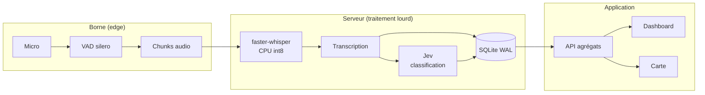

# La borne qui écoute

## Le livre d'or numérique des sites touristiques

Hackathon DGE · Gestion des flux touristiques · Isère

<!--
NOTES ORALES — accueil (15 s)

« Bonjour. Nous allons vous présenter La borne qui écoute : un livre d'or
numérique pour les sites touristiques. L'idée tient en une phrase : arrêter de
seulement compter les visiteurs, et commencer à les écouter. »
-->

---

# 1. Contexte — le visiteur, angle mort des flux

> « On vient de Lyon pour la rando.  
> C'était super, mais le parking était plein.  
> On reviendra, plutôt en semaine. »

- On **compte** les flux
- On **n'écoute** pas les visiteurs
- **Qui ? Pourquoi ? Satisfait ?**

16,7 M de nuitées en Isère · des compteurs, très peu de verbatims

<!--
NOTES ORALES — 1. Contexte (2 min)

D'où ils viennent :
- L'Isère, c'est 16,7 millions de nuitées en 2024, le 22e département français.
- Le territoire dispose déjà d'une culture de l'observation : Flux Vision, éco-compteurs,
  comptages routiers, parkings. On sait donc très bien mesurer des volumes.
- Mais ces outils disent « combien », jamais « qui », « pourquoi », ni « comment ils l'ont vécu ».

Le ressenti global :
- Les enquêtes de satisfaction existent, mais elles sont ponctuelles, coûteuses et
  déclaratives : un enquêteur, une journée, un échantillon limité, un biais de sélection.
- Résultat : on connaît la fréquentation, pas la satisfaction réelle, ni les motifs de venue,
  ni les irritants (parking, signalétique, surfréquentation).
- Le visiteur, lui, a envie de raconter sa journée. Il le fait déjà sur Google, TripAdvisor…
  mais ces avis sont publics, non structurés et non représentatifs.

L'open mic :
- Notre parti pris, c'est l'open mic : une conversation libre, pas un questionnaire.
- Le visiteur appuie sur un bouton, parle 20 secondes à 2 minutes, appuie à nouveau.
- On récupère un verbatim spontané, multilingue, sans friction, et on en extrait
  des signaux structurés : profil, origine, groupe, mode de venue, affluence ressentie,
  intention de revenir, note.
- On passe donc d'une mesure de volume à une mesure d'expérience.
-->

---
layout: two-cols
---

# 2. Le concept — l'objet, l'app, le déploiement

### L'objet — une borne qui écoute

> « Raconte-moi d'où tu viens…  
> t'es de la région ?  
> Elle t'a plu la rando ? »

Un bouton · une conversation · aucun compte

::right::

### Le livre d'or numérique

`origine` · `groupe` · `activités` · `logement`  
`durée du séjour` · `temps sur site` · `mode de venue`  
`affluence` · `parking` · `signalétique`

### L'app — un prolongement

Module **Isère Outdoor** · gamification **Catch'em'all**  
Pilote 5 sites → département → **open source**

<!--
NOTES ORALES — 2. Le concept (1 min 30)

Design de la borne :
- Une borne physique, installée au départ d'une rando, à l'office de tourisme ou sur un parking.
- Un seul bouton : parler / arrêter. Pas d'écran, pas de clavier, pas de compte.
- Le texte d'accroche est volontairement conversationnel :
  « Raconte-moi d'où tu viens, t'es de la région ? Elle t'a plu la rando ? »
- L'objectif est de déclencher une anecdote, pas de remplir un formulaire.
- Le design sera co-construit avec le territoire : figures locales, animaux, ouvrages d'art
  (voir annexe A).

Les données du livre d'or :
- Comment ils sont venus : voiture, transport en commun, vélo, à pied.
- Quelles activités : rando, baignade, patrimoine, événement.
- Où ils viennent : Isère, autre région, étranger.
- Où ils logent : camping, hôtel, famille, résidence secondaire.
- Combien ils sont : seul, couple, famille, amis, groupe organisé.
- Combien de temps sur le site et durée du séjour.
- Ce qui a coincé : signalétique, parking, affluence ressentie.
- Et bien sûr : est-ce qu'ils reviendront, et pourquoi.

L'app comme prolongement :
- On ne propose pas une énième app à installer. L'app prolonge la borne.
- Deux scénarios : un module intégré à une app existante — Isère Outdoor est
  l'intégration naturelle ; ou une application dédiée, plus ludique.
- Le moteur est le même : transcription vocale + classification. Seul le canal change.
- Gamification inspirée de Catch'em'all ou Space Invaderz : badges par massif, site,
  saison ; contribuer débloque du contenu et des itinéraires.
- Déploiement : pilote sur 5 sites, puis extension départementale avec un code open
  source paramétré par commune. Les données agrégées sont ouvertes.
-->

---

# 3. La démo

Parler → Transcrire → Classifier → Afficher

### Placeholder

Cette slide sera remplacée par le **PoC développé dans la branche dédiée**.

Worker STT local · classification Jev · SQLite · Streamlit

<!--
NOTES ORALES — 3. La démo (1 min)

Ce que vous allez voir :
- On choisit une borne (Chamrousse, Col de Porte, Molière, Les 7 Laux, Bourg-d'Arud).
- On parle 30 secondes : d'où on vient, ce qu'on a fait, ce qu'on a pensé.
- La transcription s'affiche en direct : le texte partiel en gris, le texte validé en noir.
- Puis la classification arrive : note, profil, affluence, mode de venue.
- On peut naviguer dans les demi-journées et voir les avis s'accumuler.

Sous le capot :
- Un worker local fait le STT (faster-whisper, CPU) et la VAD.
- Un appel Jev classe la conversation en quelques secondes.
- Le tout communique via SQLite ; le front est un Streamlit en deux colonnes.

À noter :
- Cette slide est un placeholder : elle sera remplacée par le PoC de la branche dédiée.
- L'audio n'est jamais conservé : seule la transcription remonte (voir annexe B).
-->

---
layout: two-cols
---

# 4. Modèle économique

### L'enquête terrain

- 2 jours d'enquêteur
- Déplacement + traitement
- **≈ 24 h de travail**
- Ponctuelle, échantillon limité

::right::

### La borne

- **CAPEX** : boîtier, micro, bouton, batterie
- **OPEX** : STT + classification par avis
- **24 h/24**, 7 j/7
- Coût marginal : **quelques centimes / avis**

Robustesse : dégradation, batterie, connectivité, 
mode hors-ligne, supervision.

<!--
NOTES ORALES — 4. Modèle économique (1 min 30)

Le coût d'une enquête terrain :
- Aujourd'hui, une enquête de satisfaction, c'est environ 24 heures de travail :
  deux jours d'enquêteur, le déplacement, puis une journée de traitement.
- C'est ponctuel, ça couvre un échantillon limité, et ça introduit un biais de sélection :
  on interroge ceux qui acceptent de s'arrêter.

Le coût d'une borne :
- CAPEX : un boîtier renforcé, un micro, un bouton, une batterie, éventuellement
  un petit panneau solaire. Des composants standard, réparables.
- OPEX : le traitement. Le STT et la classification coûtent quelques centimes par avis.
- La borne tourne 24 h/24, 7 j/7, et produit des données comparables dans le temps.

Robustesse :
- Risque de dégradation : vandalisme, intempéries → boîtier renforcé, pièces standard.
- Batterie : le froid et l'autonomie sont les points durs → dimensionnement, solaire,
  remplacement simple.
- Connectivité : zones blanches en montagne → mode hors-ligne avec stockage local
  et synchronisation différée.
- Supervision : si une borne devient silencieuse, on est alerté.
- Principe : la borne reste un capteur passif ; toute la complexité est côté serveur.
-->

---

# 5. Réutilisation des données

### Tableau de bord

Volume, note moyenne, taux de retour

### Carte de saturation

Affluence ressentie × éco-compteurs

### Profils visiteurs

Origine, groupe, mode de venue

### Lien transports

Part sans voiture, besoin de navettes

### Alertes précoces

Affluence anormale, signalétique défaillante

### API ouverte

Données agrégées pour les partenaires

Pour les gestionnaires de sites, les offices de tourisme, Isère Attractivité, Loopi…

<!--
NOTES ORALES — 5. Réutilisation des données (2 min)

Ce que l'on peut faire avec ces avis, en 2 minutes :

1. Tableau de bord flux — volume d'avis par site et par demi-journée, note moyenne,
   taux de retour. C'est l'outil de base du gestionnaire de site.

2. Carte de saturation — on croise l'affluence ressentie avec les éco-compteurs et les
   comptages parkings. On fait apparaître les zones à réorienter, pas seulement les
   zones fréquentées.

3. Profils visiteurs — origine, groupe, mode de venue. Croisé avec Flux Vision, cela
   permet de cibler les campagnes et d'adapter l'offre.

4. Lien transports — quelle part de visiteurs vient sans voiture, où manque-t-il une
   navette. C'est directement réutilisable par Loopi et les politiques de mobilité.

5. Alertes précoces — une affluence anormale, une signalétique défaillante, un parking
   saturé : on le voit dans les verbatims avant de le voir dans les compteurs.

6. API ouverte — les données agrégées sont exposées aux partenaires : offices de
   tourisme, collectivités, applications tierces.

Le message : ces données ne servent pas qu'à un rapport. Elles alimentent des outils
de pilotage au quotidien.
-->

---

# Annexe A — Formules du device

### 🦫 Marmotte

Vercors

### 🦌 Chamois

Belledonne

### 🦅 Aigle

Oisans

- **Co-construire pour l'adoption** : figures locales, animaux, ouvrages d'art
- **Matériaux** : bois local, pierre, métal patiné
- **Contraintes** : lisible de loin, une seule action, résistant au froid, réparable

<!--
NOTES ORALES — Annexe A (réponse aux questions)

Pourquoi plusieurs formules :
- Une borne générique ne crée pas d'attachement. Une figure locale, si.
- On peut décliner la borne en chamois en Belledonne, marmotte en Vercors,
  aigle en Oisans, ou s'inspirer d'ouvrages d'art artisanaux locaux.
- L'objectif est que la borne appartienne au territoire, pas qu'elle soit un objet
  technologique posé là.

Contraintes de design :
- Lisible de loin, une seule action possible.
- Résistant au froid et à l'humidité.
- Accessible : hauteur, contraste, langues.
- Réparable : pièces standard, pas de pièce propriétaire.
- Sobre : pas d'écran inutile, pas de consommation superflue.
-->

---
layout: two-cols
---

# Annexe B — RGPD

### Ce qui remonte

- La **transcription** (texte)
- Borne, date, demi-journée
- Classification (profil, note…)
- Langue détectée

::right::

### Ce qui ne remonte pas

- **Aucun audio**
- Aucun nom, e-mail, téléphone
- Aucune localisation personnelle
- Aucun identifiant persistant

<!--
NOTES ORALES — Annexe B (réponse aux questions)

Le point clé : on ne fait remonter que la transcription.
- L'audio est traité localement sur la borne, puis supprimé. Il n'est jamais stocké
  ni transmis.
- On ne demande ni nom, ni e-mail, ni téléphone. Les avis sont anonymes par construction.
- La borne et la demi-journée suffisent à contextualiser, sans identifier la personne.

Base légale et conformité :
- Intérêt légitime ou mission de service public selon le porteur.
- Information claire sur la borne : « Votre voix est transformée en texte,
  l'audio n'est pas conservé. »
- Minimisation : on ne collecte que ce qui est utile.
- Durée de conservation limitée et documentée.
- Registre de traitement, et analyse d'impact si nécessaire.
-->

---

# Annexe C — Architecture technique

La borne reste un capteur simple. Toute la complexité est côté serveur.

<!--
NOTES ORALES — Annexe C (réponse aux questions)

Le flux technique :
- Côté borne : micro, VAD (détection de voix), découpage en chunks audio.
- Côté serveur : transcription faster-whisper sur CPU, puis classification Jev.
- Stockage dans SQLite en mode WAL, puis exposition via une API d'agrégats.
- Le dashboard et la carte consomment cette API.

Pourquoi « traitement lourd » côté serveur :
- La borne reste simple, peu coûteuse, réparable.
- On peut changer de modèle STT ou de classifieur sans toucher aux bornes.
- On centralise la supervision, les mises à jour et la sécurité.

Le audio n'est pas stocké : il est traité puis supprimé, seule la transcription
est conservée.
-->

---

# Merci

## Des questions ?

 

**La borne qui écoute** — le livre d'or numérique des sites touristiques

 

Code open source · Données ouvertes · Paramétré par commune

<!--
NOTES ORALES — clôture

« Merci. En résumé : on est passé d'une mesure de volume à une mesure d'expérience.
La borne écoute, l'app prolonge, les données servent au pilotage. Et tout est
open source, paramétré par commune. »
-->
